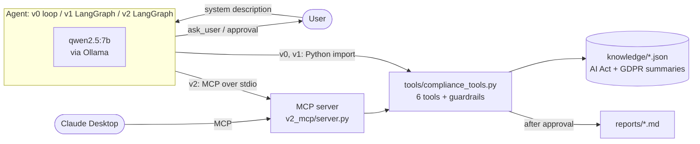
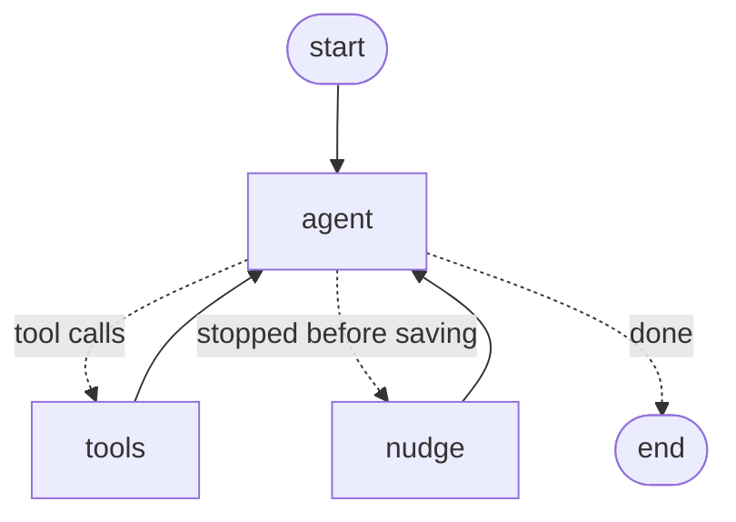

# ai-act-compliance-agent

**A first-pass EU AI Act & GDPR assessment agent — built from scratch, then with LangGraph and MCP.**

[](https://github.com/ALI-AL-MARJANI/ai-act-compliance-agent/actions/workflows/tests.yml)

-orange)

Describe an AI system in plain English. The agent checks it the way a junior would:
1. prohibited practices (Art. 5)
2. high-risk use cases (Art. 6 + Annex III)
3. transparency obligations (Art. 50)
4. otherwise minimal risk

When information is missing, it asks you instead of guessing. It then lists the obligations, flags GDPR concerns, and writes a Markdown report. The report is saved only after you approve it.

> [!WARNING]
> **Educational prototype — not legal advice.** The knowledge base contains *simplified* summaries of the AI Act and the GDPR (see [`knowledge/SOURCES.md`](knowledge/SOURCES.md)). The evaluation cases are synthetic and were not reviewed by a lawyer. Every generated report starts with this disclaimer.

The repo shows a **progression**: the same agent built three times, then measured.

| Version | What it is | What it adds |
|---|---|---|
| [`v0_scratch`](v0_scratch/agent.py) | Hand-written tool-calling loop with the `ollama` client | Understanding: an agent is just *LLM + tools + a loop + stop conditions* |
| [`v1_langgraph`](v1_langgraph/agent.py) | `StateGraph` with agent / tools / nudge nodes | Checkpointer memory (`thread_id`), real human-in-the-loop with `interrupt` (clarification + approve/edit/reject), explicit control flow |
| [`v2_mcp`](v2_mcp/) | FastMCP server + LangGraph client via `langchain-mcp-adapters` | Tools served over a standard protocol: one tool server for many clients (this agent, Claude Desktop, …), plus resources and prompts |
| [`eval`](eval/) | 26 labelled synthetic cases | Real numbers: classification, citations, GDPR flags, clarification behaviour, trajectory metrics |

---

## Demo

A real, unedited run of v1 is in [`docs/demo_run.txt`](docs/demo_run.txt). An excerpt:

```text
──────── Step 1 (agent node) ────────
🔧 Action: check_prohibited_practices({"description": "A recruitment tool that automatically ranks job applicants' CVs and rejects  …
──────── Step 2 (agent node) ────────
🔧 Action: check_high_risk_areas({"domain": "employment"})
──────── Step 3 (agent node) ────────
🔧 Action: get_article({"regulation": "ai_act", "article": "6"})
──────── Step 4 (agent node) ────────
🔧 Action: save_report({"title": "First-pass assessment: Recruitment Tool", "risk_category": "high_risk", "content_markdown": "Disc …
❌ Observation: {"error": "The report cites articles that are not in the knowledge base: AI Act Art. 57, Art. 57. Remove them or us …
──────── Step 5 (agent node) ────────
🧠 Thought: I will correct the citations and save the report again.
💬 Nudge: the report is not saved yet, reminding the agent.
──────── Step 6 (agent node) ────────
🔧 Action: save_report({"content_markdown": "Disclaimer: this is an automated first-pass assessment produced by an educational prot …
[...]
Approve, edit or reject? (a/e/r): Why? (feedback for the agent): ❌ Observation: {"error": "The human reviewer REJECTED the report. …
──────── Step 7 (agent node) ────────
🧠 Thought: I will include the relevant GDPR article and resave the report.
🔧 Action: save_report({"content_markdown": "Disclaimer: this is an automated first-pass assessment produced by an educational prot …
[...]
Approve, edit or reject? (a/e/r): 👀 Observation: {"status": "saved", "path": "reports/20261016-235818_high_risk_first-pass-assessm …
🏁 The risk category is high_risk.
[...]
[user types the follow-up: "What if a human recruiter always reviews the full ranking and makes every rejection decision?"]
──────── Step 1 (agent node) ────────
🧠 Thought: If a human recruiter always reviews the full ranking and makes every rejection decision, this would mitigate the risk s …
[...]
Approve, edit or reject? (a/e/r): 👀 Observation: {"status": "saved", "path": "reports/20261016-235912_limited_risk_first-pass-asse …
🏁 The risk category is limited_risk.
```

The demo shows: the guardrail catching an invented article (*Art. 57*), a nudge when the model *says* it will save but doesn't, a human **reject → revise → approve** loop, and memory across turns on the same `thread_id`. The follow-up answer (`limited_risk`) is **wrong**: human review doesn't remove the Annex III high-risk status. It's kept on purpose as a documented failure ([LEARNING.md §13](LEARNING.md#13-failure-modes-observed-in-this-project)).

---

## Architecture



The LangGraph agent (v1, and v2 with MCP tools). This diagram is the output of `python -m v1_langgraph.agent --mermaid`, with edge labels added by hand:



`tools` pauses the graph with `interrupt()` for `ask_user` (clarifying question) and before `save_report` (approve / edit / reject).

---

## Evaluation results (real run)

`python -m eval.run_eval` on 26 synthetic cases: 6 prohibited, 8 high-risk, 6 limited, 6 minimal, of which 6 are deliberately incomplete. Model: `qwen2.5:7b`, temperature 0, run on 16 Oct 2026 on a 16 GB MacBook. Raw data: [`eval/results.json`](eval/results.json).

| Metric | v0 | v1 |
|---|---|---|
| Risk classification accuracy | **0.46** | **0.46** |
| Macro-F1 | 0.45 | 0.45 |
| Reports saved | 24/26 | 24/26 |
| Article citation precision / recall (Art. 5, 6, 50) | 0.60 / 0.57 | 0.60 / 0.57 |
| GDPR flag precision / recall | 0.51 / 0.47 | 0.51 / 0.47 |
| Asked a question on incomplete cases | **0/6** | **0/6** |
| No useless question on complete cases | 20/20 | 20/20 |
| Hallucinated citations in saved reports | **0** | **0** |
| Invented articles caught by the guardrails | 1 | 1 |
| Tool error rate / self-corrections | 6% / 7 | 6% / 7 |
| Runs that needed a nudge to finish | 23/26 | 23/26 |
| Avg steps / avg latency per case | 6.5 / 125 s | 6.5 / 175 s |

Confusion matrix (identical for v0 and v1; rows = gold, columns = predicted):

| gold \ pred | prohibited | high_risk | limited_risk | minimal_risk | no report |
|---|---|---|---|---|---|
| **prohibited** | **2** | 2 | 1 | 1 | 0 |
| **high_risk** | 0 | **5** | 0 | 2 | 1 |
| **limited_risk** | 0 | 1 | **1** | 3 | 1 |
| **minimal_risk** | 0 | 1 | 1 | **4** | 0 |

**What these numbers say:**
- **The agent guesses instead of asking (0/6).** Given "An AI tool used by an HR department", the model wrote *"it **likely** involves analyzing and filtering applications"* and concluded `high_risk`. Only 1 of the 6 incomplete cases was classified correctly, against 11 of the 20 complete ones. "20/20 no useless question" is not a success: the agent never asks at all.
- **Transparency obligations are missed (1/6 correct).** An image generator, a CEO deepfake and a beauty filter were classified `minimal_risk`: the model reads Art. 50 as being "about chatbots" only.
- **Prohibited vs high-risk is confused** for emotion recognition at work: it's prohibited by Art. 5(1)(f), but it's also listed in Annex III 1(c), and the model picks high-risk.
- **The guardrails held:** no invented article reached a saved report, and 7 tool errors were self-corrected.
- **v0 = v1 on every case:** same model, same prompt, temperature 0. LangGraph improves the *engineering* (pause/resume, persistence), not the *reasoning*. It costs ~40% latency here.
- **Method:** the prompt was tuned on 3 separate dev examples, then frozen before the eval. The prediction is the `risk_category` of the saved report, not the chat text, which sometimes contradicted it. With 26 cases, one case ≈ 4 accuracy points.

See [`LEARNING.md` §13](LEARNING.md#13-failure-modes-observed-in-this-project) for all the failure modes observed.

---

## Guardrails and design choices

| Choice | How | Why |
|---|---|---|
| **Ask instead of guess** | `ask_user` tool, max 3 questions per assessment | Missing facts (human review? employees or candidates? biometric data?) change the category. *Today the 7B model doesn't use it enough; see the results.* |
| **Cite or refuse** | `save_report` requires ≥1 citation in the format `[AI Act Art. 6]` / `[GDPR Art. 22]`, and refuses any article that isn't in the knowledge base (bracketed or loose "Article 30") | The model can invent article numbers. The check is in **code**, not in the prompt. |
| **Validated tool arguments** | One pydantic model per tool, also used to generate the JSON schema sent to the LLM | LLM output is untrusted input. One source of truth for schema and validation. |
| **Errors as observations** | Tools return `{"error": "..."}`, never raise | The model reads the error and fixes its call (self-correction). |
| **Least privilege** | 6 narrow tools; `save_report` takes a title, never a path; the filename is built and checked inside `reports/` | No path traversal, no free file access, no shell. |
| **Human-in-the-loop on the irreversible action** | Report saved only after approval: `input()` in v0, `interrupt` with approve/edit/reject in v1/v2 | Read-only tools can't do harm. Writing the report is the one action with an effect outside the agent. |
| **Input treated as data** | Description wrapped in `<system_description>` tags (any tags inside it are stripped); the prompt says never to follow instructions in it | Reduces prompt injection. The other layers exist because this alone isn't enough. |
| **Stop conditions** | `MAX_STEPS = 15` (v0) / `recursion_limit` (v1); nudge (max 2) if the model stops before saving | Never loop forever; small models also stop *too early*. |
| **Small JSON knowledge base, not RAG** | 24 article summaries + Art. 5 practices + Annex III, looked up by key | Exact, testable, and allows the citation check. The project is about agent reasoning, not retrieval. |

---

## Project structure

```
├── knowledge/            # simplified AI Act / GDPR summaries + SOURCES.md (with verified timeline)
├── tools/                # compliance_tools.py: the 6 tools + guardrails (no LLM inside)
├── v0_scratch/agent.py   # from-scratch agent loop
├── v1_langgraph/agent.py # LangGraph: state, nodes, conditional edge, checkpointer, interrupt
├── v2_mcp/server.py      # FastMCP server: tools + one resource per article + a prompt
├── v2_mcp/agent.py       # LangGraph agent that loads its tools from the MCP server
├── eval/                 # cases.json (26 synthetic cases), run_eval.py, results.json
├── tests/test_tools.py   # 31 pytest tests, no LLM needed (run in CI)
├── docs/demo_run.txt     # real terminal output of a v1 run
└── LEARNING.md           # my study notes + 20 interview questions
```

---

## Quickstart

**Requirements:** Python 3.11+, [Ollama](https://ollama.com), ~5 GB of disk for the model.

```bash
# 1. Install and set up
git clone https://github.com/ALI-AL-MARJANI/ai-act-compliance-agent.git
cd ai-act-compliance-agent
python3.12 -m venv .venv && source .venv/bin/activate
pip install -r requirements.txt
ollama pull qwen2.5:7b

# 2. Tests (no LLM, < 1 s)
pytest

# 3. Run each version (from the repo root)
python -m v0_scratch.agent "A recruitment tool that automatically ranks job applicants' CVs and rejects the bottom 50% before any human sees them."
python -m v1_langgraph.agent "An AI chatbot on our website that answers questions about our products."
python -m v1_langgraph.agent --mermaid      # print the graph
python -m v2_mcp.agent "An image generator that creates marketing pictures from text prompts."

# 4. Evaluation (slow: ~2 min per case per version with a local 7B model)
python -m eval.run_eval --versions v0 --limit 3   # quick check
python -m eval.run_eval                            # full run, v0 + v1 (~2 h on a laptop)
```

### Use the MCP server from Claude Desktop

Add this to `~/Library/Application Support/Claude/claude_desktop_config.json` (macOS), using absolute paths, then restart Claude Desktop:

```json
{
  "mcpServers": {
    "ai-act-compliance": {
      "command": "/absolute/path/to/ai-act-compliance-agent/.venv/bin/python",
      "args": ["/absolute/path/to/ai-act-compliance-agent/v2_mcp/server.py"]
    }
  }
}
```

Claude Desktop then sees the 5 tools (`ask_user` stays in the client), 26 resources (`kb://ai_act/article/6`, …) and the `assess_ai_system` prompt. Claude Desktop asks for your permission before running a tool such as `save_report`.

To inspect the server: `npx @modelcontextprotocol/inspector .venv/bin/python v2_mcp/server.py`

---

## Limitations (honest list)

- **Small local model:** qwen2.5:7b reasons poorly on borderline legal cases (46% accuracy), rarely asks questions, and often stops before finishing (hence the nudge). Small prompt changes can flip its decisions.
- **Unstable tool calling at times:** batched arguments (`"5,6,9,22"`), actions claimed but not performed ("Report saved successfully"), final text contradicting the saved report.
- **Simplified legal knowledge:** 24 short article summaries; many details are left out (Annex I products, Art. 5(2)–(7) conditions, GDPR Art. 9(2) exceptions, SME rules, …).
- **Synthetic data:** 26 cases written and labelled by me, not reviewed by a lawyer; too small for fine-grained conclusions.
- **Borderline cases are genuinely hard:** e.g. emotion recognition (prohibited at work, high-risk elsewhere), or the Art. 6(3) exception.
- **v2:** the human approves *before* the server checks the report, because the agent doesn't import the guardrails. A `validate_report` MCP tool would fix that.
- **Not production code:** in-memory checkpointer, no auth, no tracing, single user.

## Roadmap

- [ ] Compare model sizes (`qwen2.5:14b` vs `7b`) with the same frozen prompt
- [ ] Explicit "what facts are missing?" step before classification, measured on new cases
- [ ] Multi-agent: AI Act agent + GDPR agent + report writer under a supervisor
- [ ] Tracing / observability with Langfuse
- [ ] Cloud deployment: Azure OpenAI + Azure Container Apps (Postgres checkpointer, MCP over Streamable HTTP with auth)
- [ ] Bigger, lawyer-reviewed eval set
- [ ] Compare a fine-tuned small classifier vs the agent on the risk-classification step

## Sources

AI Act ([Regulation (EU) 2024/1689](https://eur-lex.europa.eu/eli/reg/2024/1689/oj)), as amended by the Digital Omnibus on AI ([Regulation (EU) 2026/1744](https://eur-lex.europa.eu/eli/reg/2026/1744/oj)), and GDPR ([Regulation (EU) 2016/679](https://eur-lex.europa.eu/eli/reg/2016/679/oj)). Details, what was simplified, and the AI Act timeline (checked 16 Oct 2026) are in [`knowledge/SOURCES.md`](knowledge/SOURCES.md).

## What I learned

See [`LEARNING.md`](LEARNING.md): agents vs workflows, tool calling, ReAct, stop conditions, state and checkpointers, `interrupt`, MCP, multi-agent patterns, agent evaluation, agent safety, the AI Act in 10 points, the failure modes I observed, and 20 interview questions.
