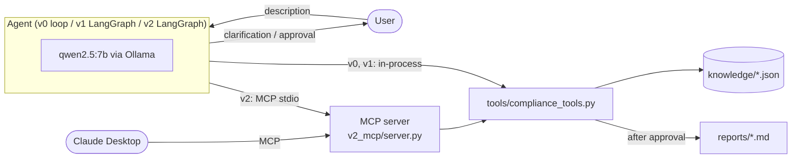
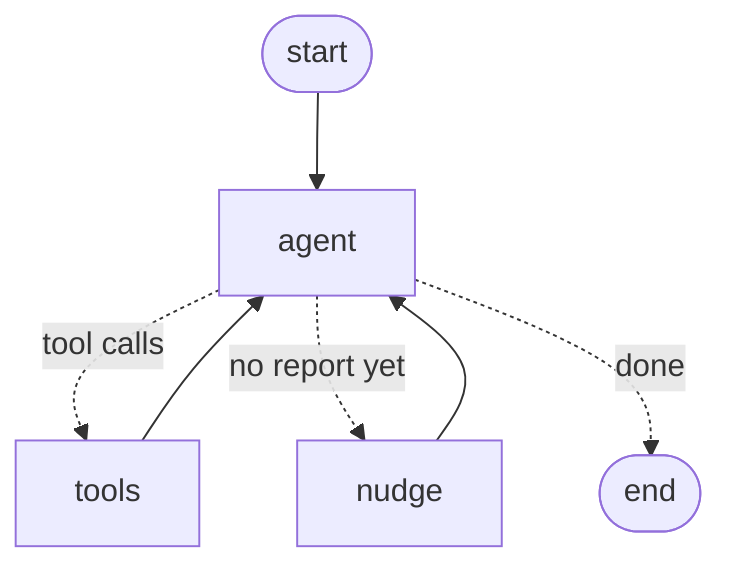

# ai-act-compliance-agent

First-pass EU AI Act and GDPR risk assessment of AI systems described in natural language. The same agent is implemented three ways (a raw tool-calling loop, LangGraph, and MCP-served tools) and benchmarked on a labelled case set.

[](https://github.com/ALI-AL-MARJANI/ai-act-compliance-agent/actions/workflows/tests.yml)

-orange)


## Overview

Given a system description, the agent:
1. screens it against Art. 5 prohibited practices;
2. screens it against Art. 6 / Annex III high-risk use cases;
3. screens it against Art. 50 transparency obligations;
4. otherwise classifies it as minimal risk.

It can request missing facts from the user, maps the category to obligations, flags GDPR issues (Art. 5, 6, 9, 22, 35), and produces a Markdown report. The report is persisted only after automated checks pass and a human approves it.

Output labels: `prohibited`, `high_risk`, `limited_risk`, `minimal_risk`.

| Implementation | Stack | Scope |
|---|---|---|
| [`v0_scratch`](v0_scratch/agent.py) | `ollama` client | Tool-calling loop, step budget, bounded nudge on premature stop, blocking approval |
| [`v1_langgraph`](v1_langgraph/agent.py) | LangGraph | `StateGraph` (agent / tools / nudge), conditional routing, `InMemorySaver` checkpointer (multi-turn per `thread_id`), `interrupt()` for clarification and approve / edit / reject |
| [`v2_mcp`](v2_mcp/) | FastMCP, `langchain-mcp-adapters` | Tools discovered and executed over MCP (stdio); knowledge base exposed as resources; usable from any MCP client (e.g. Claude Desktop) |

## Results

`python -m eval.run_eval`: 26 synthetic cases (6 prohibited, 8 high-risk, 6 limited, 6 minimal; 6 deliberately underspecified). Model `qwen2.5:7b`, temperature 0, run on 2026-10-16. Raw output: [`eval/results.json`](eval/results.json).

| Metric | v0 | v1 |
|---|---|---|
| Accuracy | 0.46 | 0.46 |
| Macro-F1 | 0.45 | 0.45 |
| Reports produced | 24/26 | 24/26 |
| Citation precision / recall (Art. 5, 6, 50) | 0.60 / 0.57 | 0.60 / 0.57 |
| GDPR flag precision / recall | 0.51 / 0.47 | 0.51 / 0.47 |
| Clarification requested on underspecified cases | 0/6 | 0/6 |
| No clarification on fully specified cases | 20/20 | 20/20 |
| Unknown articles in persisted reports | 0 | 0 |
| Unknown articles rejected by guardrails | 1 | 1 |
| Tool error rate / self-corrections | 6% / 7 | 6% / 7 |
| Runs requiring a nudge | 23/26 | 23/26 |
| Mean steps / mean latency | 6.5 / 125 s | 6.5 / 175 s |

Confusion matrix (identical for v0 and v1; rows = gold):

| gold \ pred | prohibited | high_risk | limited_risk | minimal_risk | no report |
|---|---|---|---|---|---|
| prohibited | **2** | 2 | 1 | 1 | 0 |
| high_risk | 0 | **5** | 0 | 2 | 1 |
| limited_risk | 0 | 1 | **1** | 3 | 1 |
| minimal_risk | 0 | 1 | 1 | **4** | 0 |

**Findings**
- **No clarification behaviour.** On underspecified inputs the model fills the gaps itself instead of calling `ask_user`. For example, "an AI tool used by an HR department" → *"it likely involves analyzing and filtering applications"* → `high_risk`. Accuracy is 1/6 on underspecified cases vs 11/20 on fully specified ones. The 20/20 above is therefore not informative.
- **Art. 50 under-detection.** Generative and deepfake systems (image generator, cloned-voice video, beauty filter) are labelled `minimal_risk`; only the chatbot case is recognised as `limited_risk`.
- **Art. 5 vs Annex III confusion.** Emotion recognition in the workplace is prohibited (Art. 5(1)(f)) but is also listed in Annex III 1(c); the model picks `high_risk`.
- **Guardrails hold.** No unknown article reaches a persisted report; tool errors returned as observations led to 7 self-corrections.
- **v0 ≡ v1.** Identical predictions and citations on every case: the orchestration layer does not affect reasoning at temperature 0. LangGraph adds ~40% latency here.

**Protocol.** The prompt was developed on three separate examples and frozen before the evaluation. The prediction is read from the `risk_category` argument of the persisted report, never from the final chat message, which contradicted the report in several runs. n = 26: one case ≈ 4 accuracy points.

## Example run (v1)

```text
[step 1]
action       check_prohibited_practices({"description": "A recruitment tool that automatically ranks job applicants' CVs and  …
[step 2]
action       check_high_risk_areas({"domain": "employment"})
[step 3]
action       get_article({"regulation": "ai_act", "article": "6"})
[step 4]
action       save_report({"content_markdown": "Disclaimer: this is an automated first-pass assessment produced by an educatio …
error        {"error": "The report cites articles that are not in the knowledge base: AI Act Art. 57, Art. 57. Remove them or …

[step 5]
thought      I will correct the citations and save the report again.
nudge        report not saved yet, reminder sent

[step 6]
action       save_report({"title": "First-pass assessment: Recruitment Tool", "risk_category": "high_risk", "content_markdown …
[reviewer: reject — "Please also cite GDPR Art. 22: candidates are rejected without any human review."]
error        {"error": "The human reviewer REJECTED the report. Feedback: Please also cite GDPR Art. 22: candidates are rejec …

[step 7]
thought      I will include the relevant GDPR article and resave the report.
action       save_report({"content_markdown": "Disclaimer: this is an automated first-pass assessment produced by an educatio …
[reviewer: approve]
observation  {"status": "saved", "path": "reports/20261017-000549_high_risk_first-pass-assessment-recruitment-tool.md"}

result       The risk category is high_risk.
             steps=8 stopped_by=final_answer latency=134.7s

[follow-up on the same thread: "What if a human recruiter always reviews the full ranking and makes every rejection decision?"]
...
[reviewer: approve]
observation  {"status": "saved", "path": "reports/20261017-000637_limited_risk_first-pass-assessment-recruitment-tool.md"}
result       The risk category is limited_risk.
             steps=3 stopped_by=final_answer latency=47.9s
```

Reviewer inputs are shown in brackets. The run shows a hallucinated citation (Art. 57) rejected by the guardrail, a premature stop handled by the nudge, a reject → revise → approve cycle, and a follow-up on the same thread. The follow-up answer is incorrect: human review does not remove the Annex III high-risk status (it only affects GDPR Art. 22).

## Architecture



LangGraph topology (v1, v2), from `python -m v1_langgraph.agent --mermaid` (edge labels added):



`tools` calls `interrupt()` for `ask_user` and before `save_report`.

## Design

| Concern | Implementation |
|---|---|
| Tool contract | Six pure functions, one pydantic model per tool; the same models generate the JSON schemas sent to the model. Tools never raise; failures are returned as observations. |
| Citation grounding | `save_report` requires ≥1 citation (`[AI Act Art. 6]`, `[GDPR Art. 22]`) and rejects any article, bracketed or free-text, absent from the knowledge base. Enforced in code, not in the prompt. |
| Least privilege | No shell, network or arbitrary file access. `save_report` takes a title, never a path; the filename is derived and confined to `reports/`. |
| Human oversight | Approval gates the only write action (blocking prompt in v0, `interrupt` with approve / edit / reject in v1/v2). Read-only tools are not gated. |
| Untrusted input | The description is delimited as data; delimiter tags inside it are stripped. |
| Termination | `MAX_STEPS = 15` (v0) / `recursion_limit` (v1); at most 2 nudges when the model stops before producing a report. |
| Clarification | `ask_user`, capped at 3 questions per assessment. |
| Knowledge base | 24 article summaries, Art. 5 practices and Annex III areas in JSON, looked up by key. Retrieval is unnecessary at this size, and key lookup makes citations verifiable. |
| MCP server | Guardrails run server-side, independent of the client's approval flow. Read-only tools carry `readOnlyHint`. `ask_user` is not exposed (human interaction is a client concern; stdio is the protocol channel). |

## Repository layout

```
knowledge/        regulation summaries (JSON) and sources
tools/            compliance tools and guardrails
v0_scratch/       raw tool-calling loop
v1_langgraph/     LangGraph implementation
v2_mcp/           MCP server and MCP-backed agent
eval/             cases, benchmark script, results
tests/            unit tests (no LLM), run in CI
```

## Quickstart

Requires Python ≥ 3.11 and [Ollama](https://ollama.com).

```bash
git clone https://github.com/ALI-AL-MARJANI/ai-act-compliance-agent.git
cd ai-act-compliance-agent
python3.12 -m venv .venv && source .venv/bin/activate
pip install -r requirements.txt
ollama pull qwen2.5:7b

pytest

python -m v0_scratch.agent "A recruitment tool that automatically ranks job applicants' CVs and rejects the bottom 50% before any human sees them."
python -m v1_langgraph.agent "An AI chatbot on our website that answers questions about our products."
python -m v2_mcp.agent "An image generator that creates marketing pictures from text prompts."

python -m eval.run_eval --versions v0 --limit 3   # ~5 min
python -m eval.run_eval                            # full benchmark, ~2 h on a laptop
```

### MCP client configuration (Claude Desktop)

`~/Library/Application Support/Claude/claude_desktop_config.json`:

```json
{
  "mcpServers": {
    "ai-act-compliance": {
      "command": "/absolute/path/to/ai-act-compliance-agent/.venv/bin/python",
      "args": ["/absolute/path/to/ai-act-compliance-agent/v2_mcp/server.py"]
    }
  }
}
```

The server exposes 5 tools, 26 resources (`kb://ai_act/article/6`, …) and the `assess_ai_system` prompt.

## Limitations

- A 7B local model limits reasoning on borderline cases and is sensitive to prompt wording (a single added instruction flipped a decision during development).
- Tool-calling failure modes observed: batched arguments, actions claimed but not executed, premature termination, final message contradicting the structured output.
- Simplified legal coverage: Annex I products, Art. 5(2)–(7) conditions, GDPR Art. 9(2) exceptions and SME provisions are not modelled.
- Small synthetic evaluation set, labelled without legal review.
- v2 requests approval before server-side validation; a `validate_report` tool would remove this ordering issue.
- In-memory checkpointer, no authentication, no tracing.

## Roadmap

- [ ] Model-size ablation (`qwen2.5:14b` vs `7b`, frozen prompt)
- [ ] Explicit missing-information step before classification, evaluated on held-out cases
- [ ] Supervisor with AI Act, GDPR and report-writing sub-agents
- [ ] Tracing (Langfuse)
- [ ] Azure deployment: Azure OpenAI, Container Apps, Postgres checkpointer, MCP over Streamable HTTP with auth
- [ ] Larger, expert-reviewed evaluation set
- [ ] Fine-tuned classifier baseline for the classification step

## Sources

AI Act — [Regulation (EU) 2024/1689](https://eur-lex.europa.eu/eli/reg/2024/1689/oj), amended by [Regulation (EU) 2026/1744](https://eur-lex.europa.eu/eli/reg/2026/1744/oj) (Digital Omnibus on AI). GDPR — [Regulation (EU) 2016/679](https://eur-lex.europa.eu/eli/reg/2016/679/oj). Article mapping, simplifications and the application timeline (checked 2026-10-16) are listed in [`knowledge/SOURCES.md`](knowledge/SOURCES.md).
